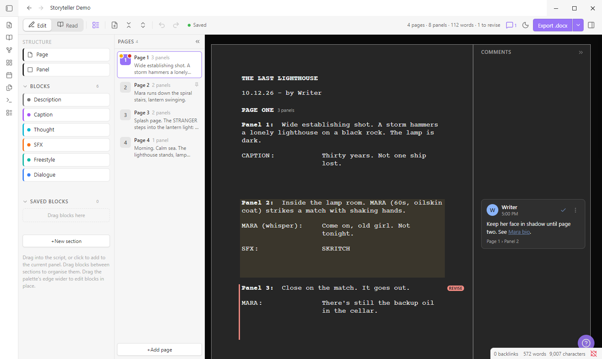
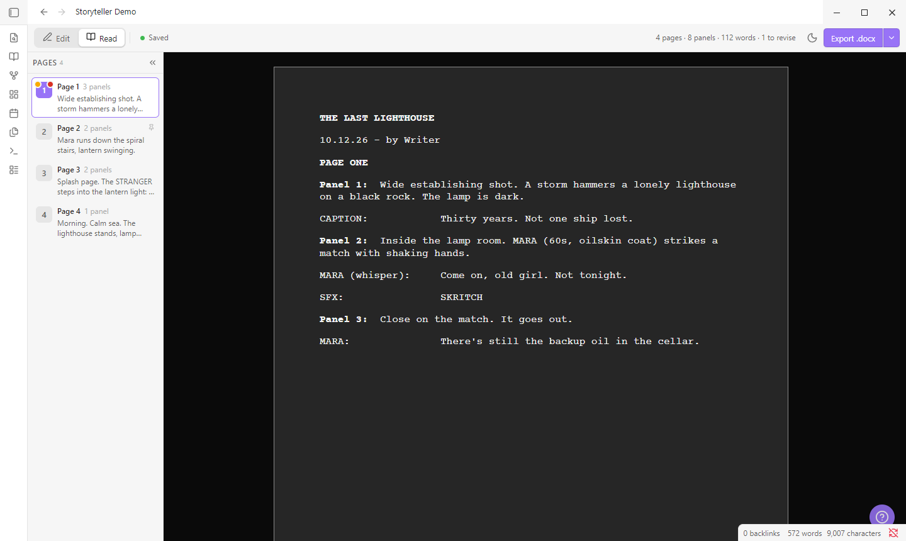
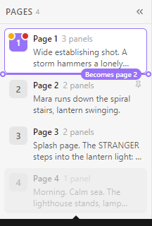
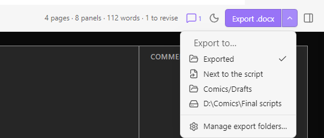

# Storyteller Comic Drafter

Draft comic scripts in Obsidian with drag-and-drop pages, panels and lettering blocks, then export them to an editable Word file.

Scripts are `.comic` files with their own editor. The editor and the export follow Greg Pak's comic script template: Courier 12pt, `PAGE ONE`, `Panel 1:` running into its description, and numbered dialogue hanging at 2".



## Features

**Writing**
- **Pages → panels → blocks.** Drag to reorder anything. Page, panel and balloon numbers update automatically.
- **Block palette.** Drag or click Description, Dialogue, Caption, Thought, SFX or Freestyle into the script. Add your own block types and save reusable blocks, then organise them into sections.
- **Quick-add row.** Each panel has a row of "+" buttons for adding blocks. Star (☆) the blocks you use most in the palette and only those appear there, in palette order, so the row stays short however big your palette gets.
- **Speaker field.** Type `MAYA (off)` and it splits into speaker and modifier. Names autocomplete from the script.
- **Formatting.** Bold, italic, underline and highlight (Ctrl+B / I / U, Ctrl+Shift+H). Freestyle blocks can also be aligned, indented, boxed or resized.
- **Read mode** (Ctrl+E) shows the script as it will print.

**Organising**
- **Pages list.** Jump to any page, drag to reorder, or collapse it to a rail of numbers. A line shows exactly where a dragged page will land.
- **Swap or move pages** from a picker, without dragging.
- **Comments** in a Google Docs-style margin, with `[[links]]` to your notes.
- **Mark for revision, pin, highlight and lock** any page, panel or block (right-click).
- **Undo** for every change, including deletes.

| Read mode | Moving a page |
| --- | --- |
|  |  |

**Exporting**
- **Export .docx** saves a Word file with the template's styles, a page break per comic page, margin comments, `[REVISE]` markers and your highlights. It then opens in Word (optional).
- **Several export folders.** Add vault folders, "next to the script", or any folder on your computer (desktop only). The ▾ arrow beside the button picks one, and the button remembers it.
- **Script folders.** Choose where new `.comic` scripts are created. With several, you're asked each time.



## Keyboard shortcuts

| Keys | Action |
| --- | --- |
| Ctrl/Cmd + B / I / U | Bold / italic / underline |
| Ctrl/Cmd + Shift + H | Highlight |
| Ctrl/Cmd + E | Edit / Read mode |
| Ctrl/Cmd + Enter | New block of the same type |
| Ctrl/Cmd + Shift + Enter | New panel |
| Alt + ↑ / ↓ | Move the current block |
| Alt + PageUp / PageDown | Previous / next page |
| Ctrl/Cmd + Z / Shift + Z | Undo / redo (outside text fields) |
| ? or Ctrl/Cmd + / | Help and all shortcuts |

## Settings

- **Block types, palette and new pages:** your own block types, and which blocks a new panel starts with.
- **Numbering:** `PAGE ONE` or `PAGE 1`; balloon numbers per page, per panel, or off.
- **Appearance:** draft font and size, light / dark / auto paper, animations.
- **Word export:** comments, revision markers, highlights, page breaks, Word font, open after export, export folders.
- **New scripts:** script folders.

## Privacy

- No network access and no telemetry.
- Reads and writes your `.comic` scripts and exported `.docx` files only. Files go outside the vault only if you add a computer folder as an export folder.
- After exporting, it can open the `.docx` in your default app. You can turn this off.

## Install (manual)

```bash
npm install
npm run build
```

Copy `main.js`, `manifest.json` and `styles.css` into `<vault>/.obsidian/plugins/storyteller-comic-drafter/` and enable the plugin under *Settings → Community plugins*. Use `npm run dev` to rebuild on save and `npm run lint` to run Obsidian's review rules.

## Tips

- Obsidian hides `.docx` files unless *Settings → Files and links → Detect all file extensions* is on. Use the export notice's **Show in file manager** link.
- For an exact template match, set *Word font* to Courier Final Draft if you have it installed.
- On touch devices, use right-click (long-press) → **Move up / Move down** instead of dragging.
