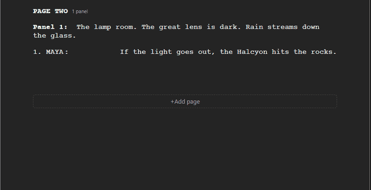
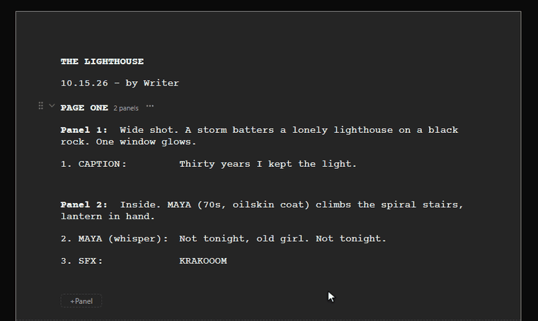
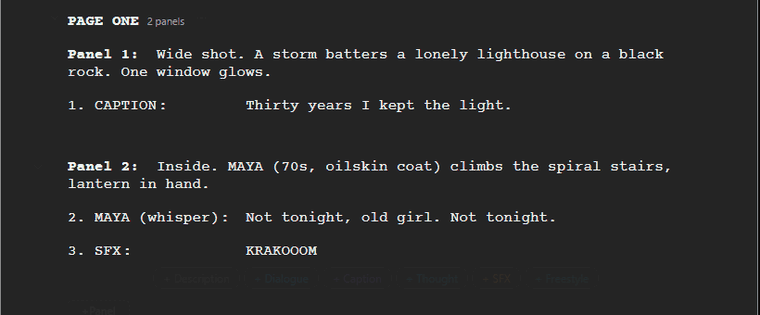
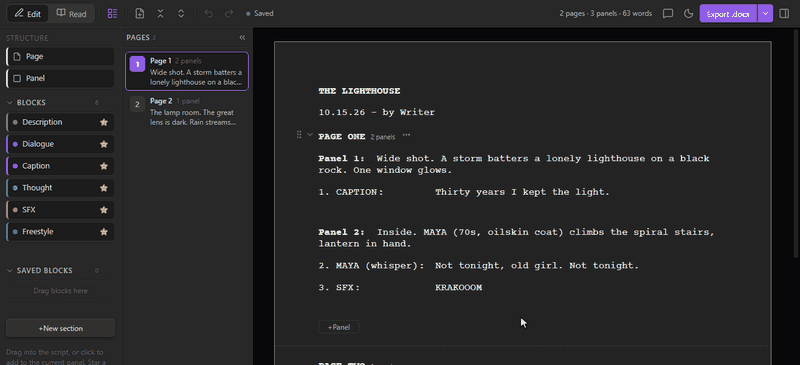
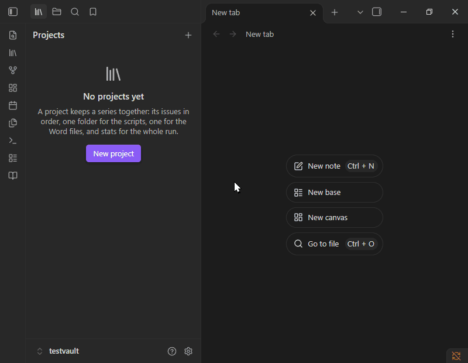
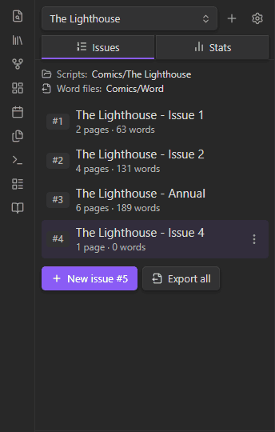

# Storyteller: Comic Drafter

Write comic scripts in Obsidian with drag-and-drop pages, panels and lettering blocks, keep a series of issues in order, and export each script to an editable Word file.

Scripts are `.comic` files with their own editor. The layout follows Greg Pak's comic script template: Courier 12pt, `PAGE ONE`, `Panel 1:` running into its description, and numbered dialogue hanging at 2".


**Contents:** [Quick start](#quick-start) · [Writing](#writing) · [Organising a script](#organising-a-script) · [Projects](#projects) · [Exporting to Word](#exporting-to-word) · [Keyboard shortcuts](#keyboard-shortcuts) · [Settings](#settings) · [Install](#install) · [Tips](#tips) · [Privacy](#privacy)

## Quick start

1. **New script:** click the book icon in the ribbon, or right-click a folder → *New comic script*.
2. **Write:** type the panel description after `Panel 1:`. Add dialogue, captions and SFX with the **+** buttons under a panel, or drag them in from the palette on the left.
3. **Review:** press **Ctrl+E** to see the script as it will print.
4. **Export:** click **Export .docx**. The Word file opens, ready for final edits.
5. **Writing a series?** Click the library icon in the ribbon to open **Projects** and keep your issues in order.

Press **?** in the editor at any time for help and every shortcut.

## Writing

- **Pages → panels → blocks.** Page, panel and balloon numbers fill themselves in and update as you rearrange.
- **Block palette.** Description, Dialogue, Caption, Thought, SFX and Freestyle, plus any block types you make. Save finished blocks to reuse them, and group them into sections.
- **Quick-add row.** Star (☆) the blocks you use most and they appear as **+** buttons under every panel.
- **Speaker field.** Type `MAYA (off)` and it splits into speaker and modifier. Names autocomplete from the script.
- **Formatting you see as you type.** Bold, italic, underline and highlights in five colours, from shortcuts or the bar over selected text. No `**` markers to type, and styles combine.
- **Freestyle blocks** for anything else (title cards, TO BE CONTINUED, notes): align, indent, box or resize them.
- **Read mode** (Ctrl+E) shows the clean script. Double-click any line to edit it.



## Organising a script

- **Drag anything.** Move blocks, panels and pages with the ⠿ grip, even into another page.
- **Pages list.** Jump to a page, drag to reorder, or collapse it to a rail of page numbers.
- **Swap or move pages** from a picker, without dragging (right-click a page).
- **Comments** in a margin like Google Docs. Comment on a whole item or on just some words (Ctrl+Alt+M), reply in threads, and link notes with `[[links]]`.
- **Revise, pin and lock** any page, panel or block from the right-click menu.
- **Undo** every change, deletes included.



| Dragging a block | Read mode |
| --- | --- |
|  |  |

## Projects

A project keeps a series together, like Longform but simpler. Open the **Projects** tab with the library icon in the ribbon, or *Open comic projects* in the command palette.



**Setting up**
- **Click + to make a project.** Give it a name, a **scripts folder** for its `.comic` issues, and a **Word files folder** for its exports (a vault folder, or any folder on your computer in the desktop app).
- **Existing folders work.** Scripts already in the folder become issues, numbered by file name ("Issue 2" before "Issue 10"). Subfolders count too.

**Issues**
- **Numbered in reading order.** Drag an issue to reorder, or right-click → *Change issue number…*.
- **One project per issue.** An issue can't be added to a second project.
- **New issue** creates the next one ("The Lighthouse - Issue 4") in the project folder and opens it.
- **Nothing gets lost.** Renaming or moving an issue keeps its number. Scripts added to the folder later wait under *Not in the index*, ready to add. *Remove from project* never deletes the file.
- **Add a script from anywhere:** right-click a `.comic` file → *Add to project…*.

**Exporting**
- **Export .docx** on any issue saves it straight to the project's Word folder.
- **Export all** writes every issue's Word file in one go.

**Stats**



- **Totals:** issues, pages, panels and words.
- **Averages:** pages per issue, panels and words per page, balloons per panel.
- **Warning signs:** the most crowded panel, open comments and pages marked for revision.
- **Per issue:** bar charts of pages and words. Click a bar to open the issue.
- **Cast:** every speaker by number of balloons, and which issues they appear in (hover).
- **Table** of every issue with totals.

Stats update as you write.

<br clear="right">

## Exporting to Word

- **Export .docx** writes the template's styles: a page break per comic page, margin comments, red `[REVISE]` markers and your highlights.
- **Opens in Word** when done (you can turn this off).
- **Choose where files go.** Add vault folders, *next to the script*, or folders on your computer. The ▾ arrow beside the button picks one and remembers it. Projects can have their own folder.


## Keyboard shortcuts

| Keys | Action |
| --- | --- |
| Ctrl/Cmd + B / I / U | Bold / italic / underline |
| Ctrl/Cmd + Shift + H | Highlight |
| Ctrl/Cmd + Alt + M | Comment on the selected words |
| Ctrl/Cmd + E | Edit / Read mode |
| Ctrl/Cmd + Enter | New block of the same type |
| Ctrl/Cmd + Shift + Enter | New panel |
| Alt + ↑ / ↓ | Move the current block |
| Alt + PageUp / PageDown | Previous / next page |
| Ctrl/Cmd + Z / Shift + Z | Undo / redo (outside text fields) |
| ? or Ctrl/Cmd + / | Help and all shortcuts |

Commands in the command palette: *New comic script*, *Open comic projects*, *New issue in the current project*, *Export current script as .docx*, and more.

## Settings

| Section | What you can change |
| --- | --- |
| Block types | Your own block types, and which blocks a new panel starts with |
| Numbering | `PAGE ONE` or `PAGE 1`; balloon numbers per page, per panel, or off |
| Editor appearance | Draft font and size, light / dark / auto paper, animations, your name |
| Word export | Comments, revision markers, highlights, page breaks, Word font, open after export, export folders |
| New scripts | Folders new scripts can be created in |

Project folders are set per project, from the ⚙ button in the Projects tab.

## Install

**From a release:** download `main.js`, `manifest.json` and `styles.css` from the [latest release](https://github.com/S-Urchin/obsidian-storyteller/releases/latest) into `<vault>/.obsidian/plugins/storyteller-comic-drafter/`, then enable *Storyteller: Comic Drafter* under *Settings → Community plugins*.

**From source:**

```bash
npm install
npm run build   # then copy main.js, manifest.json and styles.css as above
```

`npm run dev` rebuilds on save, `npm run lint` runs Obsidian's review rules and `npm test` runs the unit tests.

Needs Obsidian 1.5.7 or newer.

**Check a download:** releases are built by GitHub Actions from the tagged source and come with signed build attestations. To confirm a file is the one built from this repository, run `gh attestation verify main.js --repo S-Urchin/obsidian-storyteller` (the same works for `styles.css` and `manifest.json`).

## Tips

- **Can't see the .docx in Obsidian?** Turn on *Settings → Files and links → Detect all file extensions*, or use **Show in file manager** in the export message.
- **Exact template match:** set *Word font* to Courier Final Draft if you have it.
- **Touch screens:** long-press → *Move up / Move down* instead of dragging.
- **Spelling suggestions:** Shift+right-click inside text for the normal menu.

## Privacy

- No network access and no telemetry.
- Reads and writes only your `.comic` scripts and the `.docx` files you export. Files leave the vault only if you choose a folder on your computer.
- Project lists and settings are stored in the plugin's own `data.json` in your vault.
